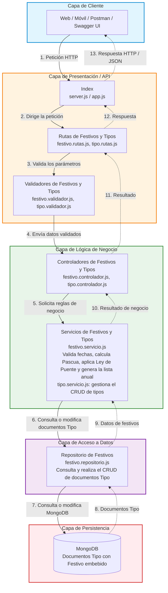

# Diagrama de arquitectura por capas — API de Festivos

La presentación recibe la petición y valida sus parámetros; el controlador, ubicado con el servicio en la lógica de negocio, coordina el caso de uso. El servicio de festivos conserva las reglas de fechas y la generación anual. El servicio de tipos gestiona la creación, consulta, actualización y eliminación de los tipos de festivo. El repositorio consulta y persiste los documentos `Tipo` con los `Festivo` embebidos en MongoDB.
