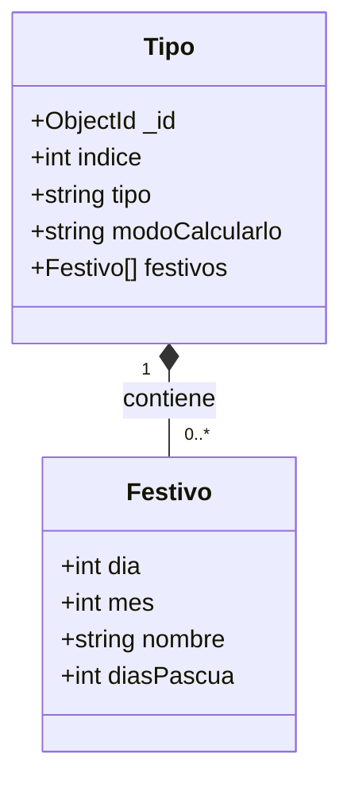

# Diagrama de modelo documental — API de Festivos

En MongoDB, cada documento persistido de **Tipo** incorpora el arreglo embebido `festivos`; no se modela como una relación entre tablas.

## Tipos de cálculo

- **Tipo 1 — Fijo:** conserva la fecha definida por `dia` y `mes`.
- **Tipo 2 — Ley de "Puente festivo":** parte de `dia` y `mes` y traslada la fecha al lunes siguiente.
- **Tipo 3 — Basado en el domingo de Pascua:** calcula la fecha desde Pascua usando `diasPascua`.
- **Tipo 4 — Pascua con Ley de "Puente festivo":** calcula desde Pascua con `diasPascua` y luego traslada la fecha al lunes siguiente.

Los tipos 1 y 2 requieren `dia` y `mes`; los tipos 3 y 4 requieren `diasPascua`. MongoDB puede omitir los campos que no apliquen a cada festivo.
